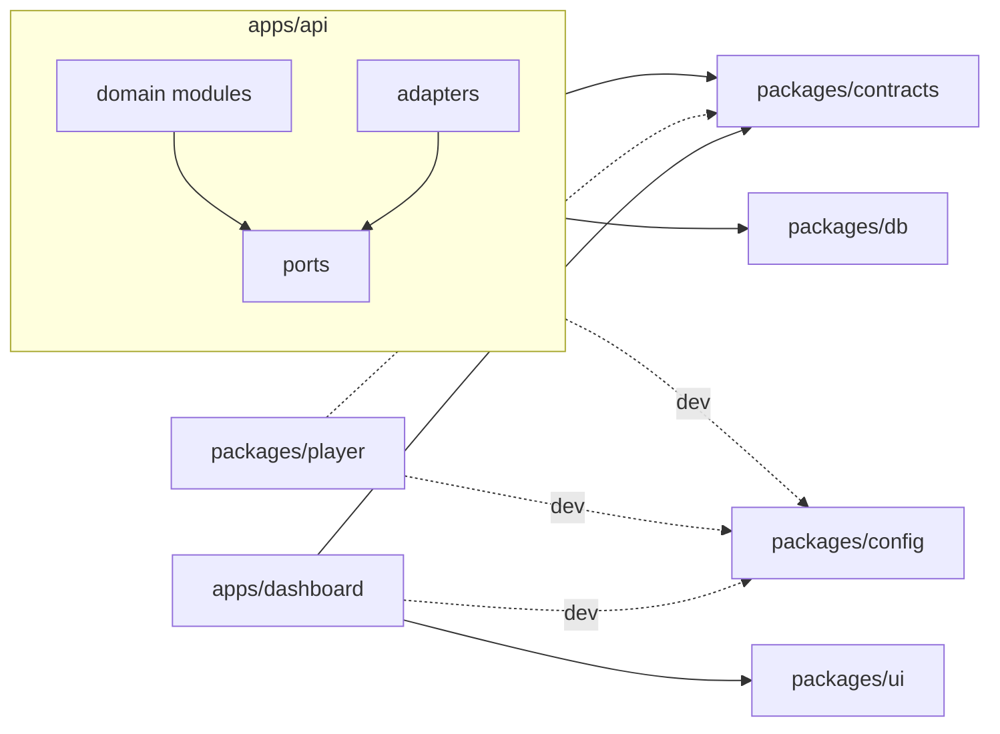
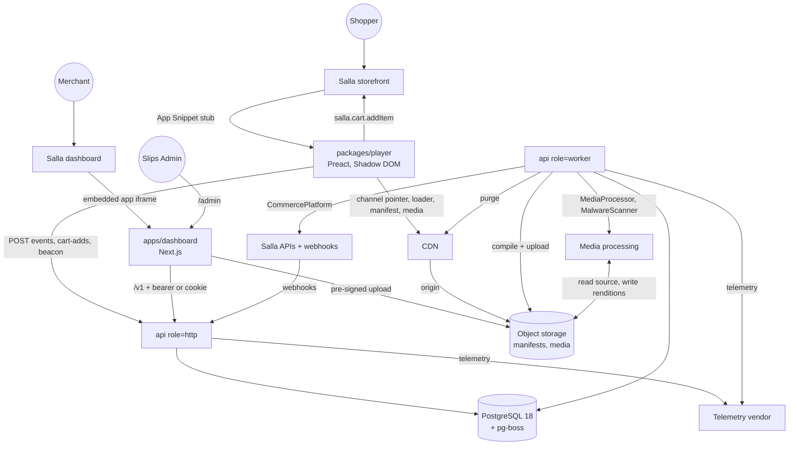
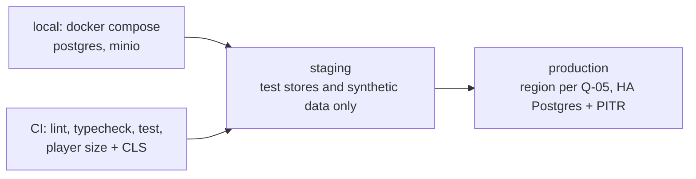
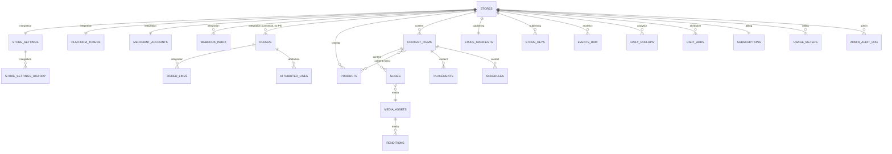

# Architecture Spine — Slips MVP

## Design Paradigm

**Modular monolith with hexagonal edges.** One NestJS codebase (`apps/api`) runs as two process roles, `http` and `worker`. Each domain module owns its tables and talks to other modules only through their service interfaces or transactional domain events (AD-17). Everything that touches an external system sits behind a port, with one adapter per provider:
- the commerce platform (Salla)
- media processing and malware scanning
- object storage
- CDN purge
- telemetry

The storefront never reads the database at render time. The `publishing` module compiles a **per-store manifest** (a read model), and the CDN serves it. Analytics is **append-only**: raw events are written once, then rolled up by jobs.

| Layer | Lives in |
| --- | --- |
| Domain modules (`integration`, `catalog`, `content`, `media`, `publishing`, `analytics`, `attribution`, `billing`, `admin`) | `apps/api/src/modules/<module>/` |
| Ports (interfaces) | `apps/api/src/ports/` |
| Adapters (Salla, storage, CDN, media, telemetry) | `apps/api/src/adapters/<provider>/` |
| HTTP controllers / worker job handlers | `<module>/http/`, `<module>/jobs/` |
| Shared wire contracts and event catalog | `packages/contracts` |
| DB schema + migrations | `packages/db` |
| Storefront player (stub, loader, viewer) | `packages/player` |
| Dashboard (incl. `/admin`) | `apps/dashboard` |

## Invariants & Rules



Arrows are the only allowed import directions (runtime calls are in the Containers view). `packages/db` is imported by `apps/api` only. The player may import `packages/contracts` for types only. Domain modules never import adapters.

### AD-1 — One API deployable, two process roles [ADOPTED]

- **Binds:** all backend work
- **Prevents:** stories spinning up separate services, queues or runtimes per feature; CPU-heavy jobs starving latency-sensitive ones.
- **Rule:**
  - `apps/api` builds one image, started as `role=http` or `role=worker`.
  - Background work (webhook handling, media jobs, manifest compile, rollups, reconciliation, schedule boundaries, domain-event handlers) runs only in `worker`, via **pg-boss** queues on the main Postgres.
  - `WORKER_QUEUES` selects queue groups (`realtime`, `media`, `batch`); `media` runs as its own worker deployment. Per-queue concurrency and the default retry policy live in one file [ASSUMPTION: 5 attempts, exponential backoff 30 s to 15 min; media 3 attempts].
  - HTTP handlers validate, persist or enqueue, and return. They never do long work inline.

### AD-2 — Module data ownership

- **Binds:** all tables, all modules
- **Prevents:** two modules writing the same entity, and hidden cross-module joins that break when one module changes.
- **Rule:**
  - Each table has exactly one owning module (Ownership map below). A test fails when a table in `packages/db` has no declared owner.
  - Only the owner writes it.
  - Other modules read through the owner's exported service (batch reads such as `getStatsByProductIds(storeId, ids)` for list pages, never N+1 per row) or react to its domain events (AD-17).
  - Read-only SQL joins across owners are allowed only inside `analytics` rollup jobs.
  - No foreign keys with cascades across module boundaries; cross-module deletes are soft (`deleted_at`) plus an event.

### AD-3 — Tenant isolation

- **Binds:** every table with merchant data, NFR3, NFR4
- **Prevents:** a query that forgets `store_id` leaking another store's data, and admin writes bypassing owner rules.
- **Rule:**
  - Every tenant table has a non-null `store_id`.
  - All tenant access goes through the `StoreScoped` repository base, which requires a store context.
  - Postgres RLS policies on `current_setting('app.store_id')` (no `missing_ok`, so a missing context fails closed) back this up. The context is set only with `SET LOCAL` through one lint-enforced helper. The app role owns no tables; tenant tables use `FORCE ROW LEVEL SECURITY`.
  - Workers set the store context per job. Cross-store jobs only fan out one job per store.
  - Only `admin` uses a separate, **read-only** DB role that bypasses RLS, and every admin read lands in `admin_audit_log`. Admin mutations call the owning module's service in the store's context with an admin actor, also audited.
  - Each tenant table needs an automated cross-tenant test.

### AD-4 — Platform port; Salla stays at the edge [ADOPTED]

- **Binds:** Q-07, FR2, FR3, FR9, FR11, FR13, FR19, FR25, FR28
- **Prevents:** Salla payload shapes leaking into domain code, which would block Zid or Shopify later; rate-limit bans and lost tokens from racing callers.
- **Rule:**
  - API side: domain modules depend on the `CommercePlatform` port (auth, products, orders, subscriptions, webhook verification), never on Salla SDKs or types.
  - Canonical entities carry `(platform, external_id)`.
  - The Salla adapter paces calls per store under Salla's rate limits and honours `Retry-After`.
  - Only `integration.getAccessToken(storeId)` refreshes tokens: single-flight per store under `pg_advisory_xact_lock`, re-reading the token after the lock, persisting the new pair in the same transaction (refresh tokens are single-use). A definitive refresh failure moves the store to `disconnected` (AD-20).
  - Player side: `StorefrontPlatform` wraps `salla.*` (config, cart, product options, events, consent, locale). Player components never call `salla` directly. Only this adapter maps Salla slugs and markup to `contracts: PageContext` (`pageType`, `targetId`, `lang`, `dir`).

### AD-5 — Shopper PII stops at the adapter

- **Binds:** NFR4.b, NFR10, FR13, FR25
- **Prevents:** shopper name, phone, email or address landing in tables, logs, queues or error trackers.
- **Rule:**
  - The Salla adapter maps order payloads to a canonical `Order` that carries no shopper PII.
  - The `http` webhook handler verifies the raw body, maps it to the canonical PII-free payload, and persists only that (AD-13). Raw bodies are never persisted, enqueued or logged; request-body logging and error-tracker capture are off on the webhook route.
  - A fixture-based test feeds a real order webhook and asserts no PII reaches the DB or logs.
  - If a shopper identifier is ever needed, store only an HMAC with a key held outside the DB.

### AD-6 — Storefront read path is a precompiled manifest on CDN

- **Binds:** FR9, FR10, FR30, NFR1, NFR2, NFR14
- **Prevents:** storefront traffic and seasonal peaks hitting Postgres, and freshness logic scattered across features.
- **Rule:**
  - `publishing` owns compiling one manifest per store (`contracts: StoreManifest`, schema major in the path). It contains only items eligible now, placements, display options, product snapshots and immutable asset URLs.
  - The manifest is served from the CDN at `/m/v<major>/<platform>/<platform_store_id>.json` (the AD-16 locator), plus the key paths of AD-16 for manual-snippet installs.
  - Recompile and purge happen only through the AD-18 compile job.
  - Only `publishing` calls `CdnPurger`, except that `media` may purge a deleted asset's URLs and the AD-20 purge job may purge a store's paths.
  - Previews use the same compiler but never the CDN (AD-23).

### AD-7 — Player loading and weight [ADOPTED]

- **Binds:** FR9, FR10, NFR1, NFR4.c, NFR5, NFR6, NFR9, Epic 5
- **Prevents:** per-store snippets, bundle bloat from shared packages, and theme CSS colliding with the player.
- **Rule:**
  - The Salla **App Snippet** is a static stub, identical for all stores. It reads `store.id` and the page context from `salla.config` and loads per AD-21. A manually pasted snippet is a fallback only (AD-16).
  - Player runtime dependencies are `preact` only. Contracts and `@salla.sa/twilight` are imported type-only (local `salla` global declaration in the adapter), with no runtime Zod, Drizzle or `@salla.sa/*` values (lint-enforced).
  - CI fails the build above 50 KB gzip for the initial payload and warns above 20 KB for core. Lazy modules each have their own CI cap [ASSUMPTION: viewer 25 KB gzip, analytics batcher 5 KB gzip].
  - The player renders inside Shadow DOM. Fonts use the system font stack (no `@font-face` in shadow roots). The only styling API is documented `--slips-*` CSS custom properties with defaults. Each shadow host sets `dir` from `StorefrontPlatform` locale.
  - The viewer owns focus trap, scroll lock (restoring position) and focus return to its opener.
  - All player telemetry goes through one `track()` that consults `StorefrontPlatform.getConsent()`; the policy per consent state is one loader config value (default deferred to Q-18).

### AD-8 — Layout-shift policy for placements

- **Binds:** NFR1, FR10, FR29, Stories 5.1, 5.5
- **Prevents:** each layout inventing its own insertion strategy and breaking the CLS test.
- **Rule:**
  - The full-screen viewer and the floating bubble mount on `document.body` as overlays.
  - Inline placements (story ring, carousel) insert only when the manifest marks them eligible **and** their anchor is below the viewport at insertion. Otherwise the placement uses the overlay entry point. Scroll is never treated as recent input.
  - Nothing reserves space before eligibility is known.
  - A Playwright CLS test on 3 themes covers no content, API timeout, and scroll past the anchor before the manifest arrives.
  - [ASSUMPTION until the CLS test on 3 themes passes: Story 1.2 / G1]

### AD-9 — Attribution is a pure recompute owned by one module

- **Binds:** FR11, FR13, FR15, E3, Stories 6.2a-c
- **Prevents:** incremental credit updates drifting from order state, lost credit from late cart confirms, and other modules computing revenue themselves.
- **Rule:**
  - `attribution` owns `cart_adds`, `attributed_lines` and the thank-you beacon endpoint.
  - A cart add counts only once the `StorefrontPlatform` add-to-cart promise has confirmed it. The player sends the cart confirm immediately (`POST /v1/cart-adds`, `keepalive`, never batched). It records the cart ID returned by that add, product, options hash, content item and timestamp; one viewer may have several cart IDs.
  - Confirmed adds exist only as `cart_adds`; the funnel's add-to-cart step counts `cart_adds`.
  - Recompute triggers: every order event (created, updated, cancelled, refunded); a new cart add whose cart ID matches an order already seen with that `checkout_id`; a daily recheck of orders from the last 15 days. Each recompute derives the order's credited lines from `(cart_adds, current canonical order)` with the FR13 rules and replaces that order's rows in one transaction.
  - The attribution window applied is the one in force at the order's `placed_at`, read from `store_settings_history` (owned by `integration`).
  - Primary join is any recorded cart ID = order `checkout_id`. The fallback is the thank-you-page beacon (`page.id` = order ID).
  - Only `attribution` converts to tax-exclusive and apportions discounts (largest remainder); rollups only sum.
  - Every other module reads attributed figures from `attribution` (or its rollups) only. The E3 ±3% reconciler in `admin` is an independent implementation that reads orders through `CommercePlatform` and shares only test fixtures with `attribution`.

### AD-10 — Event ingestion is append-only and distrustful

- **Binds:** FR12, FR14, FR15, FR26, NFR2, NFR14, NFR10
- **Prevents:** synchronous fan-out on the hot path, duplicate or spoofed events inflating metrics, and screens computing metrics differently.
- **Rule:**
  - The player batches events to `POST /v1/events`. The handler appends each batch directly to `events_raw` (Postgres, partitioned by month on server `received_at`) in one batched insert. This deviates from addendum B.3's queue; revisit trigger: the NFR14 load test.
  - The handler validates against `contracts`, checks the AD-16 locator (or an active/retiring key) and the origin against the store's synced domains, applies per-store and per-viewer rate limits, rejects events whose UUIDv7 time is outside the dedup window, and drops duplicate event IDs.
  - Back-pressure: the API returns 429 with `Retry-After`; the client retries with jitter and drops events when its buffer is full.
  - View dedup (once per item per viewer per 30 minutes) and metric formulas live only in `analytics` rollups and one `metrics` service that every dashboard endpoint uses.
  - Dashboards read only rollup tables. Today is re-rolled every 15 minutes (`final = false`). Attributed metrics are bucketed by order `placed_at` in the store time zone; an attribution recompute marks that day dirty and the rollup job re-rolls it.
  - Retention drops whole partitions; per-store erasure deletes by `store_id` in throttled batches (AD-20).

### AD-11 — Contracts are the only wire shapes

- **Binds:** all HTTP and JSON boundaries
- **Prevents:** the dashboard, player and API each defining their own DTOs, DB rows leaking to clients, and version skew between separately deployed units.
- **Rule:**
  - Every request and response body, the manifest, the event batch, domain events and job payloads are Zod schemas in `packages/contracts` (versioned `v1`), hand-written and decoupled from the DB shape (deliberate deviation from tech-stack's drizzle-zod sharing).
  - The API validates input strictly; clients parse responses non-strict. Changes within `v1` are additive only. Job payloads carry `v`, and handlers accept the current and previous version.
  - Drizzle types (and drizzle-zod schemas) stay inside `packages/db` and `apps/api`.
  - The dashboard reaches data only through the API, via TanStack Query hooks written per contract module with a query-key factory (no code generator). Next.js never connects to the DB.

### AD-12 — Identity and sessions

- **Binds:** FR1, FR27, FR28, NFR3
- **Prevents:** competing auth mechanisms per page or app, and sessions that fail inside the Salla iframe.
- **Rule:**
  - **Embedded (Salla dashboard iframe):** the API introspects the token from the embedded SDK's `getToken()` and mints a short-lived bearer access token, held in memory and sent as `Authorization`. It is refreshed by calling `getToken()` again. The session is bound to the introspected store.
  - **Direct link:** Salla OAuth, then a first-party httpOnly, Secure, SameSite=Lax cookie plus a CSRF token.
  - No third-party cookies. One merchant account per store. Idle timeout [ASSUMPTION: merchant 12 h, admin 30 min].
  - **Slips Admin:** the `/admin` route group in `apps/dashboard` has a separate sign-in and session type, and the API `admin` module has its own guard. Merchant sessions can never call admin routes.
  - Framing: the merchant app allows only Salla's dashboard origin in `frame-ancestors`; `/admin` uses `frame-ancestors 'none'`.

### AD-13 — Inbound webhooks: verify, inbox, order-safe

- **Binds:** FR2, FR3, FR19, FR25, G5, G6, NFR4.b
- **Prevents:** unverified or duplicated webhooks mutating state, older events overwriting newer ones, and PII in the inbox.
- **Rule:**
  - Verify `X-Salla-Signature` over the raw body, and require `X-Salla-Security-Strategy` = signature, before anything else. Compare timing-safe. [ASSUMPTION: HMAC-SHA256 with the app webhook secret and its encoding; confirmed against a recorded real webhook fixture from a demo store in the Epic 1 integration test.]
  - `webhook_inbox` stores only the verified canonical PII-free payload, the raw-body hash, the event type, the store's external ID and the Salla event ID. It is unique on the Salla event ID (body hash only when absent), and the handler returns 200. Inbox rows are kept 30 days.
  - Webhooks for unknown stores are parked and retried for 15 minutes, then dead-lettered; never answered with 404.
  - A worker processes inbox rows serialized per store (pg-boss singleton key). Updates are guarded writes (`WHERE source_updated_at < new`). Order webhooks are signals: the adapter re-fetches the order and applies the fetched state.
  - Daily reconciliation jobs repair any gaps.

### AD-14 — Billing state is derived, not trusted to a single event

- **Binds:** FR19, FR30, Q-04, G5
- **Prevents:** stores stuck on the wrong plan, two modules trimming different items over the limit, and reconciliation wiping a manual plan.
- **Rule:**
  - `billing` derives plan changes by comparing each `app.subscription.*` or `app.trial.*` event with the stored plan, and reconciles against the subscriptions API. `subscriptions.plan_source` is `salla` or `manual_override` (with an end date); reconciliation never replaces a live override.
  - Plan limits have one decision point, `content`: it admits items at publish time under a per-store lock and deactivates over-limit items on plan change, always via `billing.getEntitlements(storeId)`. `publishing` never trims; it filters on status only (AD-19).
  - Stores whose `store_type` is not `live` skip billing enforcement.

### AD-15 — Media pipeline behind a port

- **Binds:** FR5, NFR3, NFR11, NFR12, NFR13
- **Prevents:** a video-provider choice leaking into content or player code before Q-05 closes, and unscanned uploads going live.
- **Rule:**
  - Uploads go straight to object storage through store-scoped, size-limited pre-signed URLs (15 min expiry) from the `media` module, which also throttles abusive upload rates at issue time. Object paths are store-prefixed and content-addressed (immutable URLs).
  - Asset states: `uploaded → scanned → processed | failed`. Scanning runs through a `MalwareScanner` port; only `processed` assets can be published. External URL fetches run only in the worker through one SSRF-safe fetcher.
  - Processing runs through the `MediaProcessor` port: progressive **MP4 renditions** at 480p, 720p and 1080p (where the source allows) plus a poster. The addendum prefers a managed video service; the final choice closes with Q-05.
  - The player picks a rendition from viewport size and connection. There is no HLS in the MVP.
  - Failed jobs retry per the AD-1 policy, then mark the asset `failed` with a reason, which `media` reports to `content` as a command (AD-19).
  - Assets are referenced by slides and removed only when no slide references them.

### AD-16 — Store identity and keys [ADOPTED]

- **Binds:** FR9, FR17, FR26, NFR3, Stories 1.3, 5.1, 6.1b, 7.1b
- **Prevents:** the stub, manifest path, event validation and key regeneration each using a different store identifier.
- **Rule:**
  - The storefront locator is `(platform, platform_store_id)`. The App Snippet stub reads it from `salla.config`; the manifest path and event validation use it. There is no separate public ID.
  - `store_keys` (owned by `publishing`, states `active`, `retiring`, `revoked`) exist only for the manual-snippet fallback. Key paths serve the same manifest.
  - Regenerate creates a new `active` key and moves the old one to `retiring` for 7 days [ASSUMPTION], after which a scheduled job revokes it and triggers a compile (AD-18). Manifest key paths and event validation accept `active` and `retiring` keys only.
  - App Snippet installs need no reinstall on regenerate.

### AD-17 — Domain event transport [ADOPTED]

- **Binds:** AD-2, AD-6, AD-18, AD-19, AD-20; every cross-module reaction
- **Prevents:** events emitted in one process never reaching the other, events fired before commit or after rollback, and events lost on a crash.
- **Rule:**
  - A domain event is enqueued to pg-boss inside the same DB transaction as the state change (transactional outbox).
  - Events are consumed only by the `worker` role. Handlers are idempotent on the event ID.
  - Event names (`<module>.<entity>.<past-verb>`) and payload schemas are catalogued in `packages/contracts`, each with its owning module.
  - No in-process emitters across modules (lint-enforced).

### AD-18 — Manifest compile [ADOPTED]

- **Binds:** FR24, FR4, NFR7, NFR14, Stories 3.6, 4.3, 4.4
- **Prevents:** an older compile overwriting a newer manifest, compile and purge storms at peak, and stale storefronts from missed triggers.
- **Rule:**
  - Compile is single-flight per store (pg-boss singleton key) and debounced ~10 s per store.
  - `store_manifests.revision` increases monotonically; the job checks it before upload and never overwrites a newer revision.
  - Triggers are the events declared in one `ManifestInputs` list in `publishing`: content status and edits (AD-19), linked product changes and deletion, display and store settings changes, plan changes, key retirement (AD-16), store lifecycle changes (AD-20) and a manifest schema bump (backfill of every store).
  - `catalog` emits product events only when a manifest-visible field changes (price, sale price, availability bucket, name, image, required-options flag).
  - CTA links are checked against the store's synced domains at save and again at compile.
  - CDN TTL is 60 s with stale-while-revalidate, so a failed purge still converges. Purge failures are retried.
  - FR24 freshness is measured: each compile records the lag from its triggering event (compile-lag metric, alerted per AD-22) and the manifest size.

### AD-19 — Content state machine [ADOPTED]

- **Binds:** FR19, FR22, FR24, FR30, Epics 3-4, Stories 4.2, 4.4, 7.2c
- **Prevents:** several modules writing content status, racing schedule jobs, and the dashboard and storefront disagreeing on what is live.
- **Rule:**
  - Only `content` writes content status. Statuses are those of PRD FR22 plus **Ended** (schedule end passed; not active, shown under All). The allowed-transition table lives in `contracts`.
  - Schedule boundaries are pg-boss delayed jobs owned by `content`, with one dedup key per item and boundary, cancelled and re-queued on edit. Each transition emits an AD-17 event.
  - `publishing` only filters on status; it never evaluates time.
  - `media` (processing done or failed) and `billing` (deactivate or reactivate) request status changes via `content` commands.
  - Autosave applies only to Drafts; edits to Published items save explicitly and emit one edit event.
  - Content is soft-deleted (tombstone kept for analytics). FR30 ordering uses `first_published_at`.

### AD-20 — Store lifecycle [ADOPTED]

- **Binds:** FR2, FR25, NFR4.e, NFR10, Stories 2.5, 7.9
- **Prevents:** modules each inferring install state differently, partial deletes of a reinstalled store, and data left behind after purge.
- **Rule:**
  - `integration` owns `stores.lifecycle_state`: `active → disconnected → uninstalled` (30-day grace) `→ purged`, plus `install_epoch`, incremented on each install. Transitions emit AD-17 events.
  - Every module implements a `StoreDataLifecycle` port: export, purge and restore-on-reinstall, including media objects and CDN manifests.
  - Reinstall within the grace period restores the same store row; `(platform, platform_store_id)` is the reinstall key.
  - Purge is one orchestrated, resumable job that takes a per-store lock, re-checks state and epoch before each batch, and writes an audit record. Work carrying a stale epoch is dropped.

### AD-21 — Player release and compatibility [ADOPTED]

- **Binds:** NFR1, NFR3, NFR8, FR9, FR10, Epic 5, Story 5.6
- **Prevents:** a bad player release breaking every storefront with no way back, loader and manifest versions drifting apart, and double boot.
- **Rule:**
  - The stub loads a short-TTL pointer (channel file) naming an immutable, versioned loader. Channels are `stable` and `canary` (store cohort %). Rollback means repointing; a global kill switch flag in the pointer stops all rendering.
  - The manifest schema has a major version. Changes within a major are additive only; the loader supports the current and previous major.
  - Double-boot guard: a single global `window.__slips`; a second boot exits. The stub buffers early `cart::*` events for the loader.
  - Custom elements are `slips-player` and `slips-viewer`, defined only if not already defined.
  - The player loads only from the Slips CDN origin and the Slips API origin (both documented for merchant CSP). If either is blocked, or the manifest is missing, timed out or of an unknown major, it fails silently with no layout impact.
  - The stub source lives in `packages/player/stub`; CI checks it, and it reaches the Partners Portal only through a documented release step.

### AD-22 — Operations envelope [ADOPTED]

- **Binds:** NFR3, NFR7, NFR8, NFR10, Story 1.7, Story 7.11
- **Prevents:** each story inventing its own telemetry, unsafe migrations during rolling deploys, and missing partitions or backups.
- **Rule:**
  - From Epic 1 Story 1.7: pino logs, error tracking, metrics with SLIs per PRD NFR7, and alerting (error rate, webhook failures, queue depth and age, Salla API failures, compile lag, player errors), all behind a thin telemetry module (vendor deferred). Job payloads carry `trace_id` and `store_id`. Alerts map to owners and runbooks in `docs/runbooks/`.
  - Managed Postgres with PITR, daily encrypted backups, a quarterly restore test, and HA in production.
  - Migrations are expand/contract and compatible with the previous release. Rollback means redeploying the previous image.
  - A job creates `events_raw` partitions 3 months ahead and alerts on failure.
  - Risky features ship behind feature flags in a config table.
  - Degraded mode: a Salla outage pauses sync while manifests keep serving.

### AD-23 — Preview mode [ADOPTED]

- **Binds:** FR7, FR18, Stories 3.5, 7.3
- **Prevents:** each preview inventing its own data path or player build, and previews emitting real events or cart adds.
- **Rule:**
  - Dashboard previews embed the real player build in an iframe with a `MockStorefrontPlatform`.
  - The preview manifest comes from the same `publishing` compiler, served by a preview endpoint, never the CDN.
  - Events and cart confirms are disabled in preview.

## Consistency Conventions

| Concern | Convention |
| --- | --- |
| IDs | UUIDv7 primary keys. External IDs are kept as `(platform, external_id)`. The storefront locator is `(platform, platform_store_id)` (AD-16). |
| Time | `timestamptz` in UTC everywhere. Schedules, day boundaries and date-range presets use the store's time zone (default `Asia/Riyadh`). Schedule input is wall-clock time plus zone and only the API converts it; a store time-zone change re-anchors future schedules by wall clock. |
| Money | Integer minor units with the ISO 4217 exponent from a table in `contracts`, plus the currency code. Stored prices carry `tax_inclusive`. Attributed revenue is stored excluding VAT. Amounts in a non-base currency are flagged and never summed. |
| Errors | API errors use RFC 9457 `application/problem+json` with a stable `type` slug. User-facing text is localised in the dashboard, never in the API. |
| Naming | Tables `snake_case` plural. Modules and files `kebab-case`. Domain events `<module>.<entity>.<past-verb>`. Queues `<module>.<job>`. Salla inbox types are prefixed `salla.` and never leave `integration`. Player event types are a closed enum in `contracts`. API paths `/v1/<resource>`. |
| Logging | pino JSON logs with `request_id`, `trace_id`, `store_id`, `job_id`. No PII, tokens or secrets. |
| Config & secrets | Env vars are validated with Zod at boot. Salla tokens (`platform_tokens`) and webhook secrets are encrypted at rest (envelope encryption). Secrets are never in the repo. |
| Retention (NFR10) | Raw events 13 months. Aggregates, orders and attribution while installed plus 30 days. Logs 30 days. Backups 35 days. `webhook_inbox` 30 days. pg-boss archive 7 days. `admin_audit_log` 2 years [ASSUMPTION]. |
| i18n | `ar` and `en` message catalogs in dashboard and player. CSS uses logical properties only (`margin-inline-start`). Merchant text renders with `dir="auto"`. Numbers and currency are formatted with `Intl` in the store locale. |
| Dashboard state | Server state via TanStack Query hooks per contract module with a query-key factory; URL state (filters, tabs, pagination) via nuqs; forms via React Hook Form + contract Zod schemas; tables via TanStack Table v9 APIs (skill and examples target v8); loading states via boneyard skeletons. |
| Availability | `catalog` stores the availability bucket (Low / Out of stock); clients never recompute it. |
| Testing | Vitest for units. API integration tests run against real Postgres. Playwright for dashboard flows and the player CLS check. |

## Stack

| Name | Version |
| --- | --- |
| Node.js (LTS, min 24.15) | 24 |
| TypeScript (TS 7 only as optional fast type-check CI step) | 6.0 |
| pnpm | 12.11 |
| Turborepo | 2.11 |
| Next.js / React | 16.4 / 19.3 |
| Tailwind CSS / shadcn (CLI) | 4.3 / 4.21 |
| TanStack Query / Table (v9 APIs) | 5.104 / 9.2 |
| nuqs | 2.10 |
| React Hook Form / @hookform/resolvers | 7.89 / 5.9 |
| Zod | 4.6 |
| boneyard-js | 1.10 |
| NestJS | 12.1 |
| PostgreSQL | 18 |
| Drizzle ORM / Drizzle Kit / drizzle-zod | 0.45 / 0.31 / 0.8 |
| pg-boss | 12.37 |
| pino | 10.4 |
| Preact [ASSUMPTION: fall back to 10.29 if the Epic 1 player test on 3 themes fails] | 11.0 |
| Vite (player build) | 8.3 |
| @salla.sa/twilight (type-only devDependency) | 2.14 |
| @salla.sa/embedded-sdk (pinned exactly) | 0.2 |
| Vitest / Playwright | 5.0 / 1.64 |

## Structural Seed

### Containers



### Deployment & environments



- Every deployable is a container image built once and promoted from staging to production.
- Staging holds no real merchant data until Q-05 closes.
- DB migrations (expand/contract, AD-22) run as a separate release step before the new `http` and `worker` versions start.
- Player releases move through the AD-21 channels independently of API releases.

### Core entities



### Ownership map

| Owner | Tables |
| --- | --- |
| `integration` | `stores` (lifecycle state, install epoch, synced domains), `store_settings`, `store_settings_history` (attribution window, time zone, language, display defaults), `platform_tokens` (encrypted), `merchant_accounts`, `webhook_inbox`, `orders`, `order_lines`, `store_data_jobs` (export and purge runs) |
| `catalog` | `products`, `categories` |
| `content` | `content_items`, `slides`, `placements`, `schedules`, `content_product_links` |
| `media` | `media_assets`, `renditions` |
| `publishing` | `store_manifests`, `store_keys` |
| `analytics` | `events_raw`, `daily_rollups` |
| `attribution` | `cart_adds`, `attributed_lines` |
| `billing` | `subscriptions`, `usage_meters` |
| `admin` | `admin_users`, `admin_audit_log`, `reconciliation_runs` |
| infrastructure | pg-boss schema (no module writes it directly) |

### Source tree

```text
slips/
  apps/
    dashboard/          # Next.js App Router; (merchant) and /admin route groups
    api/
      src/modules/      # integration, catalog, content, media, publishing, analytics, attribution, billing, admin
      src/ports/        # CommercePlatform, MediaProcessor, MalwareScanner, ObjectStorage, CdnPurger, Telemetry, StoreDataLifecycle
      src/adapters/     # salla/, storage/, cdn/, media/, telemetry/
  packages/
    contracts/          # Zod wire schemas (v1): API DTOs, StoreManifest, EventBatch, PageContext, event catalog, job payloads
    db/                 # Drizzle schema, migrations (incl. partition SQL), RLS policies
    player/             # Preact player: stub/, loader, viewer; StorefrontPlatform port + salla and mock adapters
    ui/                 # shared shadcn components and tokens for dashboard and /admin
    config/             # shared tsconfig, eslint (incl. boundary rules), vitest presets
  docs/
    runbooks/
```

## Capability → Architecture Map

| Capability / Area | Lives in | Governed by |
| --- | --- | --- |
| Epic 1: foundation and Salla gate | repo scaffold, `integration`, `packages/player` stub, telemetry module | AD-1, AD-4, AD-7, AD-13, AD-16, AD-17, AD-21, AD-22 |
| Epic 2: product catalog sync | `catalog` + Salla adapter | AD-2, AD-4, AD-13, AD-18 |
| Epic 3: content creation and media | `content`, `media`, dashboard editor and preview | AD-2, AD-11, AD-15, AD-19, AD-23 |
| Epic 4: visibility, scheduling, publishing | `content` (rules, status machine, schedule-boundary jobs), `publishing` (manifest compile) | AD-6, AD-14, AD-18, AD-19 |
| Epic 5: storefront player and purchase | `packages/player`, `StorefrontPlatform` | AD-4, AD-7, AD-8, AD-9, AD-21 |
| Epic 6: analytics, attribution, dashboard | `analytics`, `attribution`, dashboard analytics pages | AD-9, AD-10, AD-11 |
| Epic 7: settings, billing, support, admin, launch | `integration` (settings), `publishing` (keys), `billing`, `admin`, dashboard settings and `/admin` | AD-3, AD-12, AD-14, AD-16, AD-20, AD-23 |
| Privacy and retention (NFR4, NFR10) | Salla adapter, `StoreDataLifecycle` in every module, `analytics` partitions | AD-3, AD-5, AD-10, AD-20, Retention convention |
| Operations (NFR7, NFR8) | telemetry module, CI/CD, managed Postgres, player channels | AD-21, AD-22 |

## Deferred

- **Hosting provider, DB region, object storage, CDN, media processing and malware-scan implementation, infra-as-code tool.** Waiting on Q-05 (data residency). The choice must offer managed Postgres 18 with HA, PITR and encrypted backups; S3-compatible storage with versioning; a CDN with a purge API and access-log export; a managed video service (preferred) or container workers that can run ffmpeg; all in the chosen region. RPO/RTO targets are set with it. Infra lives in `infra/`.
- **Observability vendor and admin sign-in provider.** The telemetry module (AD-22) isolates the vendor; revisit when Q-05 picks the provider, before staging hardening.
- **TypeScript 7.** Revisit when TS 7.1 ships a stable compiler API and typescript-eslint and the Nest CLI support it.
- **Node 26 LTS.** Revisit after Node 26 enters Active LTS (late Oct 2026), once the pilot is stable and the Q-05 host offers it.
- **Drizzle 1.0 upgrade.** Revisit when 1.0 is GA; drizzle-zod use stays inside `packages/db` and `apps/api` so the swap is local.
- **PostgreSQL 19.** Revisit when the Q-05 managed provider offers it GA.
- **Columnar analytics store.** Revisit only if rollup queries miss NFR2 in the Story 7.11 load test.
- **HLS / adaptive streaming.** Revisit if the video start-time or rebuffer SLOs are missed on pilot stores.
- **Redis or another queue; separate pools per queue class.** Revisit if queue latency P95 exceeds 30 s or pg-boss locking becomes a bottleneck in the NFR14 load test.
- **Shared rate-limit store.** Per-replica limits plus an edge per-IP rule until the NFR14 load test; revisit if it shows limits bypassed or event inflation.
- **Manifest sharding.** Revisit when any store's manifest exceeds 15 KB gzip (size metric from AD-18).
- **Unique viewers over arbitrary ranges** (non-additive across daily rollups). Revisit when Story 6.4 is sharded.
- **Exact CLS-safe insertion per layout.** AD-8 sets the policy; the details wait for the G1 and CLS results on 3 themes.
- **Attribution join confirmation.** Whether cart ID = `checkout_id` (including guest sign-in at checkout) waits for the G4 hands-on check; the AD-9 fallback is already named.
- **Consent default policy.** The `track()` seam is fixed (AD-7); the default per state waits for Q-18 and G8.

## Open Questions

| ID | Question | Owner | Needed by | Blocks |
| --- | --- | --- | --- | --- |
| Q-05 | Data residency: must data stay in KSA or the region? | Product owner (legal advice) | Before choosing the hosting provider | Provider, DB region, storage, CDN, media service (Deferred) |
| Q-18 | Consent: Salla's consent signal and the default when none exists | Product owner (legal advice) | Epic 1 gate (G8), before Story 6.1a | `track()` consent policy (AD-7) |
| G4 | Does the cart ID from `salla.cart.addItem` equal the order's `checkout_id`, incl. guest sign-in at checkout? | Spike lead | Epic 1 gate | AD-9 primary join; else thank-you beacon fallback |
| A-1 | Editing a Published item: live edits with explicit save (interim) or a draft-revision model? | Product owner with UX | Before Epic 3 stories are sharded | AD-19 edit flow |
