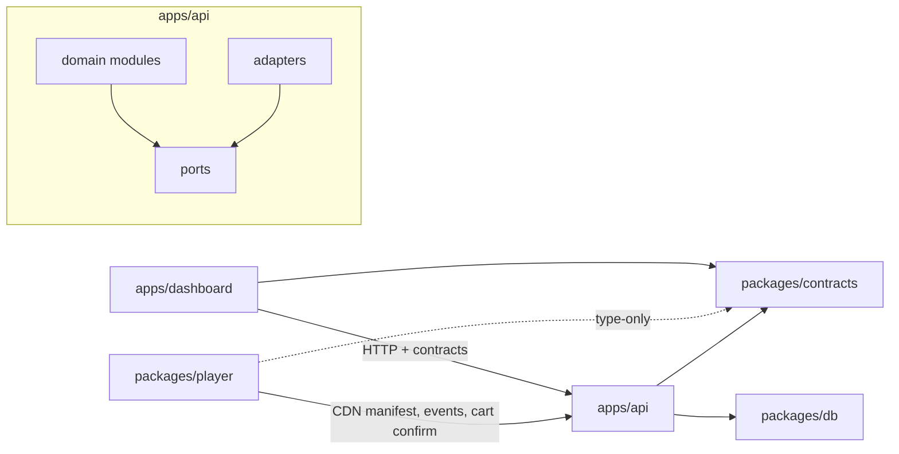
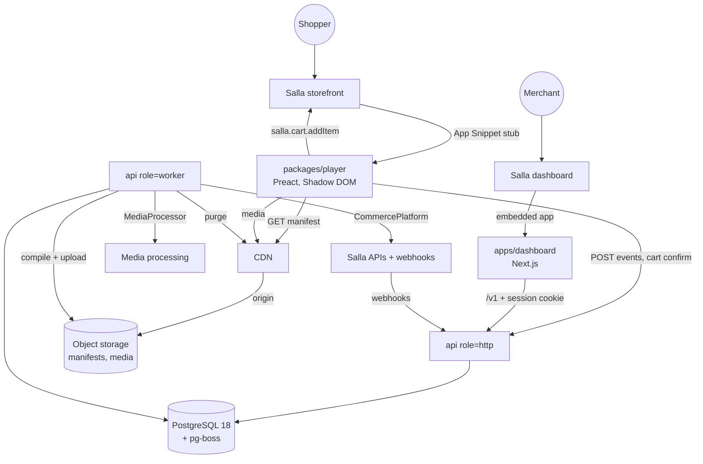
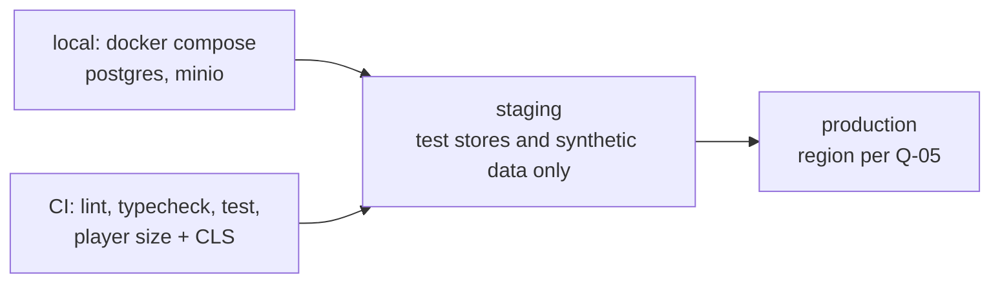
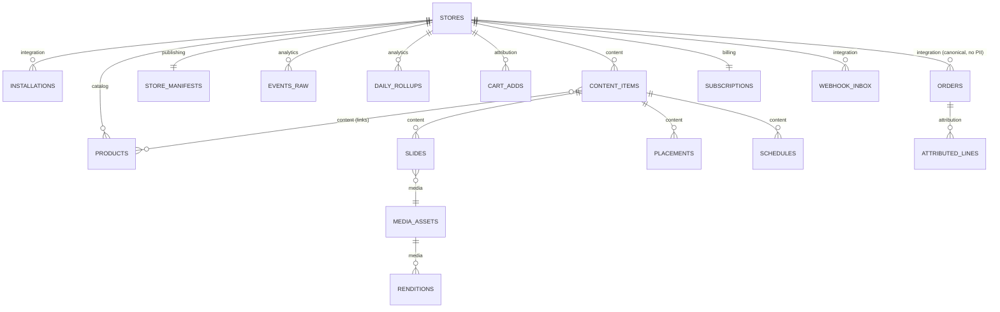

# Architecture Spine — Slips MVP

## Design Paradigm

**Modular monolith with hexagonal edges.** One NestJS codebase (`apps/api`) runs as two process roles, `http` and `worker`. Each domain module owns its tables and talks to other modules only through their service interfaces or domain events. Everything that touches an external system sits behind a port, with one adapter per provider:
- the commerce platform (Salla)
- media processing
- object storage
- CDN purge

The storefront never reads the database at render time. The `publishing` module compiles a **per-store manifest** (a read model), and the CDN serves it. Analytics is **append-only**: raw events are written once, then rolled up by jobs.

| Layer | Lives in |
| --- | --- |
| Domain modules (`integration`, `catalog`, `content`, `media`, `publishing`, `analytics`, `attribution`, `billing`, `admin`) | `apps/api/src/modules/<module>/` |
| Ports (interfaces) | `apps/api/src/ports/` |
| Adapters (Salla, storage, CDN, media) | `apps/api/src/adapters/<provider>/` |
| HTTP controllers / worker job handlers | `<module>/http/`, `<module>/jobs/` |
| Shared wire contracts | `packages/contracts` |
| DB schema + migrations | `packages/db` |
| Storefront player | `packages/player` |
| Dashboard (incl. `/admin`) | `apps/dashboard` |

## Invariants & Rules



Arrows are the only allowed dependency directions. `packages/db` is imported by `apps/api` only. The player may import `packages/contracts` for types only. Domain modules never import adapters.

### AD-1 — One API deployable, two process roles [ADOPTED]

- **Binds:** all backend work
- **Prevents:** stories spinning up separate services, queues or runtimes per feature.
- **Rule:**
  - `apps/api` builds one image, started as `role=http` or `role=worker`.
  - Background work (webhook handling, media jobs, manifest compile, rollups, reconciliation, schedule boundaries) runs only in `worker`, via **pg-boss** queues on the main Postgres.
  - HTTP handlers validate, persist or enqueue, and return. They never do long work inline.

### AD-2 — Module data ownership

- **Binds:** all tables, all modules
- **Prevents:** two modules writing the same entity, and hidden cross-module joins that break when one module changes.
- **Rule:**
  - Each table has exactly one owning module (ownership map in the ERD below).
  - Only the owner writes it.
  - Other modules read through the owner's exported service or react to its domain events (`<module>.<entity>.<past-tense-verb>`, e.g. `content.item.published`).
  - Read-only SQL joins across owners are allowed only inside `analytics` rollup jobs.

### AD-3 — Tenant isolation

- **Binds:** every table with merchant data, NFR3, NFR4
- **Prevents:** a query that forgets `store_id` leaking another store's data.
- **Rule:**
  - Every tenant table has a non-null `store_id`.
  - All tenant access goes through the `StoreScoped` repository base, which requires a store context.
  - Postgres RLS policies on `current_setting('app.store_id')` back this up, set per transaction.
  - Workers set the store context per job.
  - Only `admin` uses a separate DB role that bypasses RLS, and every admin read or write lands in `admin_audit_log`.
  - Each tenant table needs an automated cross-tenant test.

### AD-4 — Platform port; Salla stays at the edge [ADOPTED]

- **Binds:** Q-07, FR2, FR3, FR9, FR11, FR13, FR19, FR25, FR28
- **Prevents:** Salla payload shapes leaking into domain code, which would block Zid or Shopify later.
- **Rule:**
  - API side: domain modules depend on the `CommercePlatform` port (auth, products, orders, subscriptions, webhook verification), never on Salla SDKs or types.
  - Canonical entities carry `(platform, external_id)`.
  - Player side: `StorefrontPlatform` wraps `salla.*` (config, cart, product options, events). Player components never call `salla` directly.

### AD-5 — Shopper PII stops at the adapter

- **Binds:** NFR4.b, NFR10, FR13, FR25
- **Prevents:** shopper name, phone, email or address landing in tables, logs, queues or error trackers.
- **Rule:**
  - The Salla adapter maps order payloads to a canonical `Order` that carries no shopper PII.
  - Raw webhook bodies are verified and then reduced to that canonical form before they are enqueued or persisted.
  - If a shopper identifier is ever needed, store only an HMAC with a key held outside the DB.

### AD-6 — Storefront read path is a precompiled manifest on CDN

- **Binds:** FR9, FR10, FR24, FR30, NFR1, NFR2, NFR14
- **Prevents:** storefront traffic and seasonal peaks hitting Postgres, and freshness logic scattered across features.
- **Rule:**
  - `publishing` owns compiling one manifest per store (`contracts: StoreManifest`, versioned schema). It contains eligible items, placements, display options, product snapshots and asset URLs.
  - The manifest is served from the CDN keyed by the store's public ID.
  - Recompile and purge happen **only** in reaction to these events:
    - content published, unpublished or edited
    - schedule boundary (a scheduled job at each start or end time)
    - a linked product's price or stock changed
    - plan changed
    - injector key regenerated
    - app uninstalled
  - No other code purges the CDN.

### AD-7 — Player loading and weight [ADOPTED]

- **Binds:** FR9, NFR1, NFR9, Epic 5
- **Prevents:** per-store snippets, and bundle bloat from shared packages.
- **Rule:**
  - The Salla **App Snippet** is a static stub, identical for all stores. It reads `store.id` and the page context from `salla.config`, preconnects, fetches the manifest, and loads the versioned loader from the Slips CDN. A manually pasted snippet is a fallback only.
  - Player runtime dependencies are `preact` only. Contracts are imported type-only, with no runtime Zod or Drizzle (lint-enforced).
  - CI fails the build above 50 KB gzip for the initial payload and warns above 20 KB for core. The viewer and other lazy modules each have their own CI cap.
  - The player renders inside Shadow DOM.

### AD-8 — Layout-shift policy for placements

- **Binds:** NFR1, FR10, FR29, Stories 5.1, 5.5
- **Prevents:** each layout inventing its own insertion strategy and breaking the CLS test.
- **Rule:**
  - The full-screen viewer and the floating bubble mount on `document.body` as overlays.
  - Inline placements (story ring, carousel) insert only when the manifest marks them eligible **and** their anchor is outside the viewport at insertion. Otherwise they wait until the anchor leaves the viewport, or fall back to the overlay entry point.
  - Nothing reserves space before eligibility is known.
  - [ASSUMPTION until the CLS test on 3 themes passes: Story 1.2 / G1]

### AD-9 — Attribution is a pure recompute owned by one module

- **Binds:** FR11, FR13, FR15, E3, Stories 6.2a-c
- **Prevents:** incremental credit updates drifting from order state, and other modules computing revenue themselves.
- **Rule:**
  - `attribution` owns `cart_adds` and `attributed_lines`.
  - A cart add counts only once the `StorefrontPlatform` add-to-cart promise has confirmed it. It is recorded with cart ID, product, options hash, content item, timestamp and the window in force.
  - On every order event (created, updated, cancelled, refunded) the module recomputes the order's credited lines from `(cart_adds, current canonical order)` using the FR13 rules, and replaces that order's rows in one transaction.
  - Primary join is cart ID = order `checkout_id`. The fallback is the thank-you-page beacon (`page.id` = order ID).
  - Every other module reads attributed figures from `attribution` (or its rollups) only.

### AD-10 — Event ingestion is append-only and distrustful

- **Binds:** FR12, FR26, NFR2, NFR14, NFR10
- **Prevents:** synchronous fan-out on the hot path, and duplicate or spoofed events inflating metrics.
- **Rule:**
  - The player batches events to `POST /v1/events`.
  - The handler validates them against `contracts` and checks the store public ID plus origin domain. It applies per-store and per-viewer rate limits, drops duplicate client event UUIDs (v7) within the dedup window, and appends the batch to `events_raw` (Postgres, partitioned by month).
  - Dashboards read only the daily rollup tables, which scheduled jobs produce.
  - Retention drops or aggregates whole partitions.

### AD-11 — Contracts are the only wire shapes

- **Binds:** all HTTP and JSON boundaries
- **Prevents:** the dashboard, player and API each defining their own DTOs, and DB rows leaking to clients.
- **Rule:**
  - Every request and response body, the manifest, the event batch and job payloads are Zod schemas in `packages/contracts` (versioned `v1`).
  - The API validates input and output against them.
  - Drizzle types (and drizzle-zod schemas) stay inside `packages/db` and `apps/api`.
  - The dashboard reaches data only through the API (TanStack Query hooks generated per contract). Next.js never connects to the DB.

### AD-12 — Identity and sessions

- **Binds:** FR1, FR27, FR28, NFR3
- **Prevents:** competing auth mechanisms per page or app.
- **Rule:**
  - **Merchant sign-in:** the embedded-app token from the Salla dashboard is introspected server-side, with Salla OAuth as the fallback for direct links. Either way the API issues a Slips session as an httpOnly, Secure, SameSite=Lax cookie. One merchant account per store.
  - **Slips Admin:** the `/admin` route group in `apps/dashboard` has a separate sign-in and session type, and the API `admin` module has its own guard.
  - Merchant sessions can never call admin routes.

### AD-13 — Inbound webhooks: verify, inbox, order-safe

- **Binds:** FR2, FR3, FR19, FR25, G5, G6
- **Prevents:** unverified or duplicated webhooks mutating state, and older events overwriting newer ones.
- **Rule:**
  - The Salla webhook strategy is `signature`. The `X-Salla-Signature` HMAC is verified over the raw body before anything else.
  - Each webhook is stored in `webhook_inbox`, unique on the event ID (or body hash), and the handler returns 200.
  - A worker processes inbox rows, and an update applies only if the source `updated_at` is newer than the stored one.
  - Daily reconciliation jobs repair any gaps.

### AD-14 — Billing state is derived, not trusted to a single event

- **Binds:** FR19, Q-04, G5
- **Prevents:** stores stuck on the wrong plan, because Salla sends no upgrade or downgrade events.
- **Rule:**
  - `billing` derives plan changes by comparing each `app.subscription.*` or `app.trial.*` event with the stored plan, and reconciles against the subscriptions API.
  - Plan limits are enforced at publish time (`content`) and in the manifest (`publishing`), always via `billing.getEntitlements(storeId)`.
  - Stores whose `store_type` is not `live` skip billing enforcement.

### AD-15 — Media pipeline behind a port

- **Binds:** FR5, NFR11, NFR12, NFR13
- **Prevents:** a video-provider choice leaking into content or player code before Q-05 closes.
- **Rule:**
  - Uploads go straight to object storage through pre-signed URLs from the `media` module.
  - Processing runs through the `MediaProcessor` port: it produces progressive **MP4 renditions** at 480p, 720p and 1080p (where the source allows) plus a poster.
  - The player picks a rendition from viewport size and connection. There is no HLS in the MVP.
  - Failed jobs retry with backoff, then mark the asset `failed` with a reason.

## Consistency Conventions

| Concern | Convention |
| --- | --- |
| IDs | UUIDv7 primary keys. External IDs are kept as `(platform, external_id)`. The store's public ID is a separate, non-secret, indexed column. |
| Time | `timestamptz` in UTC everywhere. Schedules and day boundaries use the store's time zone (default `Asia/Riyadh`). |
| Money | Integer minor units (halalas) plus an ISO 4217 code. Attributed revenue is stored excluding VAT. |
| Errors | API errors use RFC 9457 `application/problem+json` with a stable `type` slug. User-facing text is localised in the dashboard, never in the API. |
| Naming | Tables `snake_case` plural. Modules and files `kebab-case`. Domain events `<module>.<entity>.<past-verb>`. Queues `<module>.<job>`. API paths `/v1/<resource>`. |
| Logging | pino JSON logs with `request_id`, `store_id`, `job_id`. No PII, tokens or secrets. |
| Config & secrets | Env vars are validated with Zod at boot. Salla tokens and webhook secrets are encrypted at rest (envelope encryption). Secrets are never in the repo. |
| i18n | `ar` and `en` message catalogs in dashboard and player. CSS uses logical properties only (`margin-inline-start`). Numbers and currency are formatted with `Intl` in the store locale. |
| Dashboard state | Server state via TanStack Query; URL state (filters, tabs, pagination) via nuqs; forms via React Hook Form + contract Zod schemas; loading states via boneyard skeletons. |
| Testing | Vitest for units. API integration tests run against real Postgres. Playwright for dashboard flows and the player CLS check. |

## Stack

| Name | Version |
| --- | --- |
| Node.js (LTS) | 24 |
| TypeScript | 7.0 |
| pnpm | 12.11 |
| Turborepo | 2.11 |
| Next.js / React | 16.4 / 19.3 |
| Tailwind CSS / shadcn (CLI) | 4.3 / 4.21 |
| TanStack Query / Table | 5.104 / 9.2 |
| nuqs | 2.10 |
| React Hook Form / @hookform/resolvers | 7.89 / 5.9 |
| Zod | 4.6 |
| boneyard-js | 1.10 |
| NestJS | 12.1 |
| PostgreSQL | 18 |
| Drizzle ORM / Drizzle Kit / drizzle-zod | 0.45 / 0.31 / 0.8 |
| pg-boss | 12.37 |
| pino | 10.4 |
| Preact | 11.0 |
| Vite (player build) | 8.3 |
| @salla.sa/twilight (storefront SDK, types) | 2.14 |
| @salla.sa/embedded-sdk | 0.2 |
| Vitest / Playwright | 5.0 / 1.64 |

## Structural Seed

### Containers



### Deployment & environments



- Every deployable is a container image built once and promoted from staging to production.
- Staging holds no real merchant data until Q-05 closes.
- DB migrations run as a separate release step before the new `http` and `worker` versions start.

### Core entities and owners



### Source tree

```text
slips/
  apps/
    dashboard/          # Next.js App Router; (merchant) and /admin route groups
    api/
      src/modules/      # integration, catalog, content, media, publishing, analytics, attribution, billing, admin
      src/ports/        # CommercePlatform, MediaProcessor, ObjectStorage, CdnPurger
      src/adapters/     # salla/, storage/, cdn/, media/
  packages/
    contracts/          # Zod wire schemas (v1): API DTOs, StoreManifest, EventBatch, job payloads
    db/                 # Drizzle schema, migrations (incl. partition SQL), RLS policies
    player/             # Preact player, StorefrontPlatform port + salla adapter, stub + loader builds
    ui/                 # shared shadcn components and tokens for dashboard and /admin
    config/             # shared tsconfig, eslint (incl. boundary rules), vitest presets
  docs/
```

## Capability → Architecture Map

| Capability / Area | Lives in | Governed by |
| --- | --- | --- |
| Epic 1: foundation and Salla gate | repo scaffold, `integration`, `packages/player` stub | AD-1, AD-4, AD-7, AD-13 |
| Epic 2: product catalog sync | `catalog` + Salla adapter | AD-2, AD-4, AD-13 |
| Epic 3: content creation and media | `content`, `media`, dashboard editor (preview embeds the real player) | AD-2, AD-11, AD-15 |
| Epic 4: visibility, scheduling, publishing | `content` (rules), `publishing` (manifest, schedule-boundary jobs) | AD-6, AD-14 |
| Epic 5: storefront player and purchase | `packages/player`, `StorefrontPlatform` | AD-4, AD-7, AD-8, AD-9 |
| Epic 6: analytics, attribution, dashboard | `analytics`, `attribution`, dashboard analytics pages | AD-9, AD-10, AD-11 |
| Epic 7: settings, billing, support, admin, launch | `billing`, `admin`, dashboard settings and `/admin` | AD-3, AD-12, AD-14 |
| Privacy and retention (NFR4, NFR10) | Salla adapter, `analytics` partitions, uninstall jobs | AD-3, AD-5, AD-10 |

## Deferred

- **Hosting provider, DB region, object storage, CDN and media-processing implementation.** Waiting on Q-05 (data residency). Whatever is chosen must offer managed Postgres 18, S3-compatible storage, a CDN with a purge API, and either container workers that can run ffmpeg or a managed transcoder, all in the chosen region.
- **Columnar analytics store.** Revisit only if rollup queries miss NFR2 in the Story 7.11 load test.
- **HLS / adaptive streaming.** Revisit if the video start-time or rebuffer SLOs are missed on pilot stores.
- **Redis or another queue.** Revisit if pg-boss throughput or locking becomes a bottleneck under the NFR14 load test.
- **Exact CLS-safe insertion per layout.** AD-8 sets the policy; the details wait for the G1 and CLS results on 3 themes.
- **Attribution join confirmation.** Whether cart ID = `checkout_id` waits for the G4 hands-on check; the AD-9 fallback is already named.
- **Consent gating of tracking.** Waits for Q-18 and G8 (Salla's cookie-bar signal is undocumented for partners).
- **Admin sign-in provider and observability vendor** (error tracking, metrics). Can wait until Epic 7 and staging hardening; no story depends on the choice.
